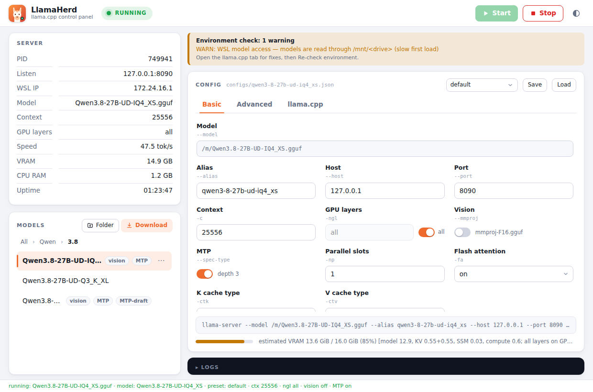
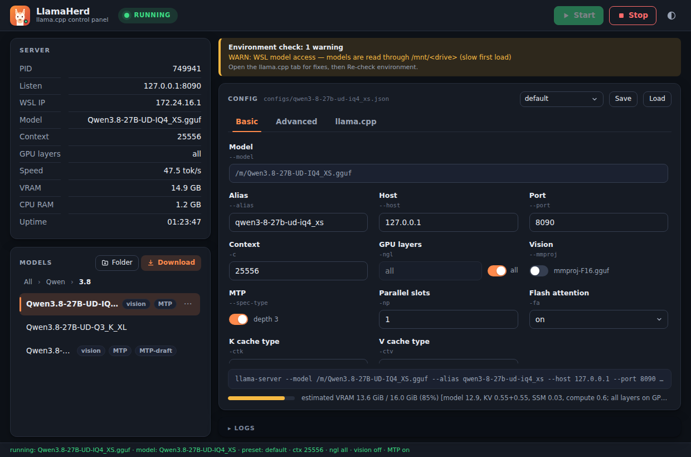

# LlamaHerd

A desktop control panel for [llama.cpp](https://github.com/ggml-org/llama.cpp)'s
`llama-server`: pick a GGUF model, tune it in a form, press **Start**. One Go binary gives
you the GUI, a CLI and a local control API for scripts and AI agents.

<p align="center">
  
  
</p>

> **Status: early.** Linux (incl. WSL) and Windows 11 are exercised; macOS builds but has
> not been run yet. Expect rough edges. Open work: [`BACKLOG.md`](BACKLOG.md).

## Features

- Model browser with nested categories (rename, move, create folders from the UI/CLI/API),
  search/filter, favorites and rescan.
- Download from Hugging Face: hardware-scored catalog, resumable, sha256-verified; vision
  and MTP sidecars detected; installed badge and free-disk readout.
- Import local `.gguf` files or folders (button or drag-and-drop; optionally pairing a vision
  projector) with duplicate detection, and create fitted presets.
- Licence-aware downloads: the repo's licence is shown before downloading, gated repositories
  explain how to get access, and the downloaded model keeps its repo/licence in the details.
- Config form for the common `llama-server` flags, per-model presets as plain JSON
  (duplicate/reset/export), auto-fitted context and GPU layers, inline validation and a
  live VRAM budget.
- Start/stop/restart, crash detection (with the server log tail and Retry/Stop), live
  VRAM/RAM, average tokens/s and 10-minute performance charts.
- Benchmark the loaded model + config with a fixed prompt; results are stored per config
  fingerprint and shown in a fastest-first table.
- One-click **Open chat** launches llama-server's built-in web UI; a model-details panel
  shows architecture, quant, trained context, sidecars and provenance.
- **VRAM pre-flight guard**: refuses a start predicted to exceed 90 % of GPU memory.
- One-click llama.cpp update/rebuild, environment check (`llamaherd doctor`).
- Light/dark UI; Linux, Windows 11 (native or WSL), macOS.
- Loopback API hardened against cross-origin and DNS-rebinding requests; token generated
  on first setup.
- **No telemetry.** The only outbound requests are model downloads you start, a metadata-only
  catalog refresh and an update/rebuild you press. See [security and privacy](docs/security.md).

### Privacy

LlamaHerd collects nothing: no analytics, no crash reporting, no account. The app only talks
to `huggingface.co` for repos/downloads, `raw.githubusercontent.com` for the model catalog,
and GitHub when you explicitly update llama.cpp. Catalog refresh can be disabled with
`LLAMAHERD_CATALOG_URL=off`; local import and the rest of the app work fully offline.

## Install

```bash
curl -fsSL https://raw.githubusercontent.com/halilcagriakkuzu/llamaherd/main/scripts/install.sh \
  | bash -s -- --from-release
```

Windows, building from source and all options: [docs/installation.md](docs/installation.md).
No `llama-server` yet? The installer offers to clone and build llama.cpp from source (or you
can point it at an existing build); a GGUF model is still needed — see the
[quickstart](QUICKSTART.md).

## Use

```bash
llamaherd                      # GUI
llamaherd doctor               # check binary, GPU, libs, models dir, port
llamaherd list                 # models and presets
llamaherd open <alias>         # start llama-server
llamaherd status | stop
llamaherd download list        # models that fit this machine
```

The same actions are available over HTTP on `127.0.0.1:8517`. The API is token-protected by
default (see `apiToken` in your config, or set `LLAMAHERD_API_TOKEN`; `"off"` disables it):

```bash
curl -s -H "Authorization: Bearer $LLAMAHERD_API_TOKEN" \
  127.0.0.1:8517/status | jq '.status, .server.tokPerSec'
```

## Documentation

| | |
| --- | --- |
| [Quickstart](QUICKSTART.md) | install → first model in five minutes |
| [Installation](docs/installation.md) | installer options, build from source, releases |
| [Configuration](docs/configuration.md) | config file, env vars, presets, library, HF token |
| [Security and privacy](docs/security.md) | API threat model, outbound hosts, offline use |
| [CLI and API](docs/cli-and-api.md) | every subcommand and endpoint |
| [Windows and WSL](docs/windows-and-wsl.md) | three Windows setups, platform limits |
| [VRAM guard](docs/vram-guard.md) | how the estimate works |
| [Managing llama.cpp](docs/llama-cpp.md) | locating, updating, force-stop |
| [Troubleshooting](docs/troubleshooting.md) | common problems |
| [Architecture](docs/architecture.md) | design, packages, Wails contract |
| [AGENTS.md](AGENTS.md) | contributor / coding-agent guide (build, test, conventions) |
| [Changelog](CHANGELOG.md) · [Backlog](BACKLOG.md) | what shipped · what's open |

## Contributing

Issues and pull requests are welcome. Start with [`AGENTS.md`](AGENTS.md): it lists the
build, test (`go test ./...` needs no GPU) and lint commands and the project conventions.

## License

[The Unlicense](LICENSE) — public domain.
Built on [llama.cpp](https://github.com/ggml-org/llama.cpp) and [Wails](https://wails.io/);
not affiliated with the llama.cpp project.
